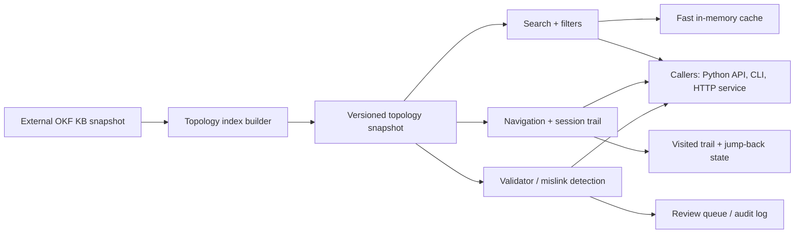

# KB Topology Design

## 1. Purpose

This document defines the design of `kb_topology`, a Python package that navigates, searches and validates an OKF knowledge base using its link topology. It is used as a library, from the command line, or as an HTTP service over the same functions. There is no user interface. It is grounded in the scientific framework described in [Topology Methods Applied to OKF Knowledge Base](../../TOPOLOGY_METHODS.md) and translated into a production-ready engineering design.

The system is intended to:

- build a topology graph/index over a provided OKF KB snapshot,
- expose it through a Python API, a CLI and an optional HTTP service,
- validate and improve existing reference links,
- provide caching for faster navigation and retrieval,
- support fast navigation and search,
- preserve a session trail for backtracking and contextual exploration,
- detect weak, misleading, or incorrect references,
- allow edges to be filtered by tag, provenance, confidence, and validation status.

### 1.1 Non-goals

- The tool does not generate, modify, or write back to the KB. The KB is read-only input owned by upstream generators.
- The tool does not copy KB content. The index stores identifiers, derived metrics, and references (path plus content hash) into the KB. Text shown to users is read from the KB on demand.
- The tool does not define a new link format. Edges are whatever the KB already declares in OKF frontmatter.

### 1.2 Relationship to KB producers and servers

An OKF knowledge base is usually produced by a generator and may be served by a catalog application that offers its own search and link views. This tool does not replace those and does not depend on them. It reads a bundle directory and adds what such systems typically lack: link validation, fix proposals, topology metrics (components, articulation points, Jaccard neighborhoods), semantic search with graph-distance highlighting, review decisions and session trails. The tool imports no code from any KB producer, and it implements its own link extraction (5.1.2), so it can be used on any OKF bundle.

## 2. Scientific foundation

The mathematical base is a finite graph:

$$
G = (V, E)
$$

where:

- \(V\) is the set of concepts/documents,
- \(E\) is the set of known relations,
- connectivity encodes topical cohesion,
- neighborhoods reflect local semantic context,
- articulation points identify structural bridge concepts,
- Jaccard-based similarity provides a metric over semantic signatures.

This is the formal basis for the project. The implementation is a computational realization of the topology layer that supports indexing, repair, validation, and navigation.

## 3. Design goals

1. Build a versioned topology graph/index from a provided KB snapshot.
2. Make navigation, search and validation available to scripts, services and agents through one set of functions (library, CLI, HTTP).
3. Support tag-based filtering and search.
4. Keep the system scalable beyond 15K concepts.
5. Treat graph suggestions and validation as operational decisions, not just visualization.
6. Preserve provenance and human reviewability for every topology-generated link.
7. Keep ingestion ownership external and avoid duplicating upstream scanner responsibilities.
8. Treat the KB as read-only. The index holds references into the KB, never a copy or a modified version.
9. Derive the graph only from what the KB declares: frontmatter `references` and markdown links in concept bodies. Anything the KB does not declare is computed by this tool and labeled as derived.
10. Keep all tool-owned state (review decisions, sessions, scores) in a separate store, so KB regeneration never destroys it.

## 4. High-level architecture



## 5. Components

### 5.1 KB input adapter

Reads a provided OKF KB directory (read-only) and normalizes it into the internal canonical topology model. It is the only component that touches KB files.

Input: the root of an OKF bundle directory for one environment, for example `.okf/prod`. How the bundle gets onto the local disk (a copy from object storage, a checkout, a build output) is up to the caller. The adapter only reads the directory. It never writes to it and ignores its `.cache` and `.git` directories.

The snapshot is identified by the environment name, the bundle's `VERSION` file (when present), and the content hash of every concept file.

**Environment.** Bundles for different environments usually have identical internal paths. The environment cannot be read from the files. It is an explicit setting (`env`, `--env`), defaulting to the bundle directory name, and it is stored in the snapshot metadata. It is the prefix of every node id.

#### 5.1.1 OKF field mapping

| Topology model | OKF source | Rule |
|---|---|---|
| `Node.id` | `<env>:<path>`, e.g. `prod:/area/group/item.md` | The path is the same form OKF uses in `references[].id`. The env prefix makes the id unique across environments. Stable across rebuilds. |
| `Node.path` | file path relative to the KB root | The part after `<env>:`. |
| `Node.type` | frontmatter `type` | Types that embed an identifier (e.g. `Policy.Code:20240009`) are split at `:` into `type_family` and `type_qualifier`. Filters use `type_family`. |
| `Node.title` | frontmatter `title` | |
| `Node.bundle` | first path segment (`docs`, `data`, ...) | Also equals `references[].bundle`. |
| `Node.tags` | frontmatter `tags` | Namespaced tags (`group:finance`) are kept whole and also indexed by namespace. |
| `Node.status` | frontmatter `status` | e.g. `stable`, `deprecated`. |
| `Node.source_refs` | frontmatter `sources[]` | |
| `Node.kb_ref` | path plus content hash | Pointer back into the KB. |
| `Edge` | each entry of frontmatter `references[]` (`bundle`, `id`, `title`) | One directed edge from the declaring file to `id`. |
| `Edge.provenance` | declaring node's `generated.by` | e.g. `process:generate_docs`. |
| `Edge.status` (declared) | declaring node's `status` and `verified[]` | Verified entries (`by`, `at`) carry through as evidence. |

#### 5.1.2 Edge source policy

Links in an OKF bundle are graph edges. Two classes are ingested, and each edge records which one it came from (`declared_in`).

| Class | Source | Rank |
|---|---|---|
| `frontmatter` | `references[]` in frontmatter | Higher. Declared, structured, carries `bundle` and `title`. |
| `body` | Markdown links in the body: `](target)` and `href="target"` anchors | Lower. In a real bundle of about 14K concepts, 80% of the edges were declared only here, so body links matter for connectivity. |

- If both classes declare the same pair, the edge is stored once with `declared_in = [frontmatter, body]`.
- Body-link extraction: markdown `](target)` links and `href` anchors, relative targets resolved against the declaring file, external links (`http`, `https`, `mailto`, `#`, `//`) skipped, and self-links skipped. Fragments (`#section`) and query strings are stripped before resolving. Links to a file that exists but is not a concept (for example `index.md`) are counted in diagnostics and create no edge. Links to a missing file become flagged edges.
- Measured on one real bundle (14,197 concepts): 82,332 unique edges and 9 isolated nodes. 16,472 edges are declared in frontmatter (12,738 of them also in the body) and 65,860 only in the body. With frontmatter alone, about 62% of nodes would be isolated.
- Relative links (`../x.md`) are resolved against the declaring file, so `../../a/b.md` from `/x/y/z.md` is `/a/b.md`. A link extractor that strips leading dots before resolving would turn `../x.md` into `/x.md` and drop or misdirect such links. In the real bundle this affected 520 body links.
- A frontmatter `references[].id` that does not resolve creates a dangling edge, kept in the index, flagged `broken`, and sent to the review queue. Body links to missing targets are handled the same way.
- A body-only edge is reported to the KB generator owners as a candidate to promote into `references[]` (see 9.2). The owners are whoever maintains the KB generator.

#### 5.1.3 Tolerance rules

- A node is a markdown file with a non-empty frontmatter `type`. `index.md`, `log.md`, `README.md` and the `.cache` and `.git` directories are skipped. A file with no `type` or invalid frontmatter is not a node. It is listed in adapter diagnostics (`skipped_no_type`, `invalid_frontmatter`). A link that points to such a file is counted (`links_to_non_concept`) and creates no edge.
- Missing optional fields are stored as null, never defaulted to invented values.
- Non-markdown files (`.json`, `.py`, `.cache/`) are ignored.

### 5.2 Topology graph/index builder

Creates the canonical topology graph/index from the provided KB snapshot.

Responsibilities:

- normalize concept IDs and relation attributes,
- preserve and type existing edges,
- compute topology diagnostics and validation signals,
- maintain provenance metadata, and the validator's confidence once an edge is scored,
- assemble a versioned topology snapshot hash for retrieval/caching. The hash covers the environment, the bundle `VERSION`, and each file's path and content hash.

### 5.3 Topology index

This is the core graph index used for navigation and validation.

It includes:

- adjacency list index,
- reverse adjacency for fast back-links,
- connected component map,
- articulation point cache,
- tag-to-node lookup,
- search index and filter metadata,
- degree per node.

Precomputed top-k neighborhood suggestions are not implemented.

### 5.4 Search and filtering layer

The system supports:

- full-text search on concept metadata,
- tag filters,
- relation-type filters,
- confidence/provenance filtering,
- status filtering (`validated`, `needs-review`, `likely-misleading`).

Implemented keyword search is BM25 over node metadata: title (weight 3), tags (2), type (1.5), path, resource and description (1 each). Identifiers are split on punctuation and camel case, so `ALPHA_BETA.comp.ledger` and `AccountTransaction` index as separate words. Query words of 3 or more characters also match longer indexed words that start with them, at half weight. An exact title match adds a fixed bonus. Document bodies are not indexed. Scores are relative to a query and not comparable across queries. Column and section names, which the design wants for embeddings, need body reads and are added with the semantic layer.

### 5.5 Semantic search and topology-aware highlighting

Embedding provider. Embeddings come from a provider behind a fixed interface (`embed(texts) -> vectors`). The model always runs from the local disk, on the developer's machine or on the web server's local drive, so no KB text leaves the machine and no hosted service is used.

- Default model: `all-MiniLM-L6-v2` (384 dimensions) from `~/.semantic_search/models/all-MiniLM-L6-v2` (`model.safetensors` and `tokenizer.json`). The directory is set with `--model-dir` or `KB_TOPOLOGY_MODEL_DIR`.
- It runs in numpy (about 70 lines), so no torch install is needed. Its output was checked against the torch and transformers implementation of the same weights: maximum difference 1.5e-7.
- Input is truncated to 128 tokens. Embedding text starts with the title, type, tags and description, then the path words, then up to 30 column names and 10 section headings read from the concept file, so identity comes first.
- Vectors are cached on disk under the state directory (`--state-dir`, `KB_TOPOLOGY_STATE_DIR`, default `./.kb-topology`), keyed by a hash of the model id and the exact text. A rebuild embeds only nodes whose text changed. The first full build for a bundle of 14,197 nodes takes about 5.5 minutes on one CPU core. Loading the cache takes about 1 second.
- The server builds vectors in a background thread. Until they are ready, `/search/semantic` returns 503 with the build progress. `GET /kb/{kb_hash}/search/semantic/status` and `/summary` report the state (`pending`, `building`, `ready`, `failed`, or `disabled` when no model is configured). `python -m kb_topology embed` builds the cache ahead of time.

Ranking is hybrid. For each candidate, `semantic_score` is the cosine similarity and `keyword_score` is the BM25 score divided by the best BM25 score of the query. `match_score = (1 - w) * max(cosine, 0) + w * keyword_score` with `w = 0.3` by default, because identifier-style names such as `ALPHA_BETA.comp.ledger` match better by keyword than by embedding. Candidates are the top results of each method.

The search layer supports semantic retrieval for a free-text query and returns context-related nodes, not only exact keyword matches.

Pipeline:

1. Embed query text and node text/signatures into the same vector space.
2. Retrieve candidates by cosine similarity and by keyword score, and rank them by `match_score` (blend described above). Keep the top `top_k`.
3. Apply graph expansion from matched nodes with hop-based decay to compute a highlight score for nearby nodes.
4. Return direct hits and expanded-context nodes in one list. Each item carries its scores, hop distance and the direct match it was reached from, so a caller can decide what to show.

Recommended scoring:

$$
\text{highlight\_score}(v)=\max_{m \in M} \left(\text{match\_score}(m)\,e^{-\alpha\,\mathrm{dist}_G(m,v)}\right),
$$

where \(M\) is the set of direct matches and \(\alpha\) controls decay speed. Defaults: `top_k` 10, `expand_hops` 2 (maximum 3), `alpha` 0.7, `min_highlight` 0.05, at most 100 expanded nodes. Expansion reaches a node with more than 300 neighbors but does not continue through it (`max_via_degree`), so a hub such as a schema page cannot light up half the graph. Direct matches have `highlight_score = match_score`. `min_highlight`, `expand_hops` and `max_via_degree` are the bounds the risk section calls for; the starting values are not tuned.

Reading the result: direct matches have `hop_distance` 0 and the highest `highlight_score`. Nodes further away score lower, and the caller can drop or de-emphasize nodes below a threshold of its choosing.

### 5.6 Navigation service

Traversals use resolved edges only. Connected components and articulation points are computed once per snapshot. Component 0 is the largest, and every node summary carries `component_id` and `is_articulation_point`. `/path` can avoid hub pages through `avoid_type` and `max_via_degree`: an index or overview page that links to hundreds of items otherwise creates shortcuts between unrelated concepts. LRU caches for neighborhood and path queries are not implemented, because these queries run in a few milliseconds on a bundle of 14K concepts.

Sessions are kept in memory (up to 1,000 sessions, the least recently used evicted, up to 10,000 visits each) and written to the state database, so trails survive a restart. Evicting a session deletes its rows.

This layer provides the graph query functions behind the library API and the HTTP endpoints.

Examples:

- current node neighborhood,
- shortest path between two concepts,
- visited trail and jump-back options,
- filtered traversal by tag and relation type.

### 5.7 Validation engine

The validator inspects existing edges instead of only creating new links.

Evidence the validator may use beyond the frontmatter edge itself:

- whether the target resolves,
- whether the target is deprecated (`status`),
- whether the source body also links to the target (corroboration),
- whether the declared `title` still matches the target's `title`.

It computes:

- semantic mismatch score,
- topology discontinuity score,
- outlier score relative to peer edges,
- relation-type consistency score.

Implemented signals and weights (starting values, to be recalibrated from review decisions). Each signal scores 0 or 1 and risk is the noisy-OR of `weight × score`.

| Signal | Weight | Fires when |
|---|---|---|
| `broken_target` | 1.0 | the target file does not exist |
| `bundle_mismatch` | 0.4 | declared `references[].bundle` differs from the target's bundle |
| `type_outlier` | 0.4 | the type pair is under 1% of its source family's edges |
| `deprecated_target` | 0.35 | the target is `deprecated` and the source is not |
| `title_mismatch` | 0.2 | declared `references[].title` differs from the target's title after normalization (case, punctuation, a prefix such as "— SQL") |
| `discontinuity` | 0.1 | both endpoints have at least 3 other neighbors and share none |

`semantic_mismatch` stays null until the embedding provider exists. Status thresholds: risk 0.3 and above is `needs-review`, 0.8 and above is `likely-misleading`. `confidence` is `1 - risk_score` and is also recorded on the edge.

It then assigns a validation status:

- `validated`
- `needs-review`
- `likely-misleading`

### 5.8 Packaging and Python API

The package is `kb_topology`. The functions below are also available through the CLI and the HTTP service.

```python
import kb_topology as kt

snap = kt.load_snapshot(".okf/prod")     # reads the bundle, never writes to it (optional: alias_rules=...)
analysis = kt.analyze(snap)              # validations, fix proposals, retirement report
nav = kt.Navigator(analysis)

nav.neighbors(node_id, direction="out", depth=2)
nav.shortest_path(a, b, via_ok=nav.via_filter(["Index"], None))
total, hits = kt.SearchIndex(snap).search("invoice audit report", limit=20)
fixes = [f for f in analysis.fixes if f.problem == "broken-target"]   # f.proposed is a references[] entry
```

The public API is the set of names in `kb_topology.__all__`: the snapshot, edge and node types, `load_snapshot`, `AliasRules`, `analyze`, `Navigator`, `SearchIndex`, `StateDB`, `ReviewStore`, `SessionStore`, and the prototype classes. Semantic search (`MiniLMProvider`, `EmbeddingStore`, `SemanticService`) and the HTTP service (`create_app(snapshots, provider=..., state_dir=...)`) are also exported, but are imported on first use because they need optional dependencies. Importing the core pulls in neither numpy nor FastAPI, and a missing extra raises an `ImportError` that names it. The console script `kb-topology` (also `python -m kb_topology`) provides the commands `index`, `report`, `embed`, `serve` and `calibrate`.

Distribution: `pip install kb-topology` installs the core and its only dependency, PyYAML. Extras are `server` and `semantic`; `all` installs both. The wheel is pure Python and contains no KB content or model weights. The model directory is configured at run time (see 5.5). The package supports Python 3.13 and newer, is licensed under Apache-2.0, and ships a `py.typed` marker.

The prototype in `kb_topology/graph.py` and `main.py` (synthetic KB, reference repair) is separate from this and is left unchanged.

Submodules such as `kb_topology.adapter` stay importable, but only the names in `__all__` are covered by the version number. Before 1.0 they may change in minor releases.

## 6. Data model

### Node

```text
Node {
  id: string              // <env>:<kb-path>, e.g. prod:/area/group/item.md
  env: string             // e.g. prod, dev
  title: string
  type: string            // raw frontmatter type
  type_family: string     // type split at ':'
  type_qualifier: string|null // the part after ':', e.g. 20240009
  bundle: string
  tags: list[string]
  status: string          // declared, from frontmatter
  source_refs: list[string]
  kb_ref: { path: string, content_hash: string }
  description: string|null // first 300 characters of the frontmatter description
  metadata: map           // small declared scalars only (e.g. row_count, resource), no document body
}
```

### Edge

Fields marked *declared* come from the KB. Fields marked *derived* are computed by this tool and stored in the tool's own index.

```text
Edge {
  source_id: string       // declared: file that holds the reference
  target_id: string       // declared: references[].id
  declared_bundle: string|null // declared: references[].bundle (frontmatter edges only)
  declared_title: string|null  // declared: references[].title (frontmatter edges only)
  declared_in: list[string] // derived: frontmatter | body (one or both)
  provenance: string      // declared: source node's generated.by
  declared_status: string // declared: source node's status
  resolved: bool          // derived: target_id exists in the KB
  relation_type: string   // derived: "<source type_family> -> <target type_family>"
  relation_alias: string|null // derived: alias from user-supplied rules (see below), or null
  confidence: float|null  // derived by the validator (1 - risk), null until scored
  declared_ref_index: int|null // position in the source's frontmatter references[], if declared there
}
```

`relation_type` is the pair of endpoint type families (for example `Guide -> Procedure`). It is set on every edge. The KB declares no relation type, so it is a computed label and is not authoritative.

`relation_alias` is an optional short label for a type pair, such as `backs` or `uses`. The tool defines no aliases of its own. They come from rules the caller supplies as a JSON file, `--aliases FILE`, `$KB_TOPOLOGY_ALIASES`, or `<state-dir>/aliases.json` (in that order), or as an `AliasRules` object passed to `load_snapshot`. Without rules every `relation_alias` is null and `relation_type` is still set.

```json
{"rules": [
  {"alias": "backs", "source": "Guide", "target": "Procedure"},
  {"alias": "uses",  "source": "Procedure", "target_prefix": "Data"}
]}
```

A rule needs `alias` and at least one of `source`, `target`, `source_prefix`, `target_prefix`. All conditions a rule gives must hold, the first matching rule wins, and types are compared by type family. A malformed file is rejected with an error that names the rule. Aliases are for filtering and display (`relation_alias` filters on the HTTP endpoints). Nothing else in the tool depends on them.

### Validation result

```text
EdgeValidation {
  source_id: string
  target_id: string
  validation_status: string
  risk_score: float
  confidence: float               // 1 - risk_score
  semantic_mismatch: float|null   // null until a semantic score exists
  scores: map[string, float]      // signals that fired, 0..1 each
  evidence: list[EvidenceItem]    // { kind, detail, score }
  recommended_action: string
  validated_at: timestamp
}
```

### Semantic search result

```text
SemanticSearchHit {
  node_id: string
  semantic_score: float   // cosine similarity (0 for expanded nodes)
  keyword_score: float    // BM25 normalized to 0..1 (0 for expanded nodes)
  match_score: float      // blend used for ranking and highlighting (0 for expanded nodes)
  hop_distance: int
  highlight_score: float
  match_type: string      // direct | expanded
  evidence: map           // { matched_from: id of the direct match that gave this highlight }
}
```

## 7. Query and API model

### Core graph endpoints

Node ids contain `:` and `/` and are passed as-is in the URL path, for example `/kb/{kb_hash}/node/prod:/area/group/item.md/neighbors`.

- `GET /kb/{kb_hash}/links` (forward and reverse link maps; supports `?node={id}&direction=out|in`)
- `GET /kb/{kb_hash}/node/{id}/neighbors?direction=&depth=1..3&relation_alias=&relation_type=&declared_in=&validation_status=&min_confidence=&bundle=&type_family=&tag=&status=&limit=` (edge filters apply to edges walked, node filters to nodes reached)
- `GET /kb/{kb_hash}/path?from={id}&to={id}&directed=&avoid_type=&max_via_degree=` (404 when no path exists with the given filters)
- `GET /kb/{kb_hash}/search?q={query}&bundle=&type_family=&tag=&status=&limit=` (keyword search, see 5.4)
- `GET /kb/{kb_hash}/search/semantic?q={query}&top_k={n}&expand_hops={h}&alpha={a}&keyword_weight=&min_highlight=&max_via_degree=&max_expanded=&bundle=&type_family=&tag=&status=`
- `GET /kb/{kb_hash}/search/semantic/status`
- `GET /kb/{kb_hash}/tags`
- `GET /kb/{kb_hash}/tag/{tag}/neighbors` (members of the tag and the nodes just outside it that members link to, by link count)
- `GET /kb/{kb_hash}/topology` (connected components and articulation points)
- `GET /kb/{kb_hash}/links/validation?status=needs-review&min_risk=0.6`
- `POST /kb/{kb_hash}/links/validate` (body: list of edges; returns each edge's validation and its fix proposals)
- `GET /kb/{kb_hash}/fixes?problem=&recommended_action=&source_id=&min_confidence=`
- `GET /kb/{kb_hash}/retirement?category=`
- `GET /kb/{kb_hash}/summary`
- CLI: `python -m kb_topology report --bundle .okf/prod --out artifacts` writes `fixes.json`, `promote_to_frontmatter.json`, `needs_review.json`, `retirement.json` and `summary.json`.

### Session endpoints

- `POST /session/{session_id}/visit`
- `GET /session/{session_id}/trail`
- `GET /session/{session_id}/jump-back-options`

### Review endpoints

- `POST /kb/{kb_hash}/links/review` (body: `source_id`, `target_id`, `decision`, optional `correction`, `note`, `reviewer`; a `corrected` decision requires `correction`)
- `GET /kb/{kb_hash}/review/queue?status=&min_risk=`
- `GET /kb/{kb_hash}/review/decisions?decision=&state=`
- `GET /kb/{kb_hash}/review/history?source_id=&target_id=`
- `GET /kb/{kb_hash}/review/calibration?min_samples=`

### Filter semantics

Filters apply on:

- `bundle`
- `type_family`
- `relation_type`
- `provenance`
- `status`
- `confidence` (edges not yet scored are excluded from confidence filters)
- `tags` (full tag or namespace)
- `validation_status`

## 8. Navigation model

User behavior is treated as a traversal process over the graph.

The system tracks:

- current node,
- visited nodes in order,
- time stamps,
- semantic neighborhoods,
- user jump-back points,
- local exploration context.

A session is a trail that the caller maintains by recording visits. The tool stores and returns it. It does not drive any display.

For semantic search sessions, traversal can begin from query-matched nodes and continue via highlighted neighborhoods, enabling contextual exploration without losing global graph orientation.

## 9. Review and validation workflow

The validator does not automatically delete questionable edges. Instead, it classifies them for review.

Workflow:

1. Compute edge risk from topology and semantic evidence.
2. Assign status: `validated`, `needs-review`, or `likely-misleading`.
3. Surface to a review queue.
4. Allow human approval or correction.
5. Persist the decision and recalibrate the scoring model (9.4).

This ensures the validator remains auditable and safe in production.

### 9.1 Where decisions live

The tool never edits the KB. Review decisions are stored in a separate tool-owned store, keyed by `(source_id, target_id, kb_ref content hashes)`.

The store is one SQLite file, `<state-dir>/state.db` (`--state-dir`, `KB_TOPOLOGY_STATE_DIR`, default `./.kb-topology`). It also holds session trails. It is never written inside the KB.

- A decision records the edge, the decision (`approved`, `rejected`, `corrected` with the corrected `references[]` entry), an optional note and reviewer, the validator's risk and fired signals at that moment, and the content hashes of both endpoint files. Decisions are append-only. The latest one for an edge is current, and earlier ones stay available as history.
- When KB files are regenerated, a decision whose source and target hashes are unchanged carries over (`state: fresh`).
- When either hash changes, or a missing target now exists, the decision is `stale` and the edge returns to the review queue.
- `GET /kb/{kb_hash}/review/queue` lists flagged edges that have no fresh decision, highest risk first, each with its fix proposals. Validation listings carry the current decision as `review`.
- A `recommended_action` that would change the KB (remove or retarget a reference) is exported as a report or patch suggestion for the KB owners or the upstream generators. Applying it is out of scope.

### 9.4 Recalibration

For each signal, `GET /kb/{kb_hash}/review/calibration` counts the latest decisions where that signal fired. `rejected` and `corrected` confirm the signal, `approved` dismisses it. Precision is confirmed over fired. A weight is read as the probability that a firing signal marks a real problem, so once a signal has at least 20 decisions (`min_samples`) its suggested weight is its precision, with a floor of 0.05. The response also counts decisions that rejected or corrected an edge no signal had flagged (`missed_by_validator`).

Nothing is applied automatically. `python -m kb_topology calibrate --state-dir DIR` prints the suggestions, and `--apply` writes them to `<state-dir>/weights.json`. The server reads that file at startup, so new weights take effect on restart. Values outside 0..1 and unknown signal names in the file are ignored.

### 9.2 Fix proposals

For each flagged edge the tool returns a proposal that the requestor can apply, so a finding always comes with a correction.

```text
FixProposal {
  edge: { source_id, target_id, declared_in }
  location: string           // "references[3]" for frontmatter, "body" for a body link
  problem: string            // broken-target | bundle-mismatch | title-mismatch | body-only
  current: { bundle, id, title } | null     // null for body-only
  proposed: { bundle, id, title } | null    // ready-to-paste references[] entry; null = no automatic fix
  candidates: list[{ id, path, score, reason }]   // broken-target only, best first
  confidence: float
  recommended_action: string // retarget | review-candidates | remove-or-recreate | update-bundle | update-title | promote-to-frontmatter
}
```
Candidates for a broken target are scored in this order of strength: same path ignoring case (0.95), same file name elsewhere (0.85, or 0.7 if several), same name ignoring punctuation and case (0.8), and, only when none of those match, a close name by edit similarity (ratio × 0.75, cutoff 0.85). A candidate in the same top-level bundle as the broken path gets +0.03. A target is proposed (`retarget`) when the best candidate scores at least 0.75 and is strictly ahead of the second; otherwise `proposed` is null and the action is `review-candidates` or `remove-or-recreate`. `body-only` proposals recommend adding the link to frontmatter. A `deprecated-target` finding has no proposal, since the correct replacement is not derivable from the bundle.
The tool does not apply proposals. They are returned through the API and exported as a report for the KB owners or the generator maintainers, because bundle files are regenerated and a direct edit would be lost.

### 9.3 Retirement candidates

A node is a retirement candidate only when all hold: it has no resolved links in the combined (frontmatter and body) graph, and it carries a retirement signal (`status: deprecated` or `row_count: 0`). Isolated nodes without a signal are listed separately as `isolated-review`. Files with no valid frontmatter go to adapter diagnostics, not to this report. On the real 14K-concept bundle this gave 1 candidate and 8 isolated-review nodes.

The report is advice for the KB owners. The tool never deletes anything.

## 10. Scalability strategy

**Measured baseline**: one real OKF bundle with 14,197 concepts and 82,332 unique edges (16,472 declared in frontmatter). KBs like this grow, and each environment is a separate snapshot.

Measured on a development laptop with that bundle: building the index takes 4.0 s, peak process memory is about 270 MB (about 240 MB above an idle interpreter, mostly during parsing), and the cached embeddings add 22 MB (14,197 × 384 float32). Query timings are in the requirements document, section 4. The larger rows are linear extrapolations of the measured baseline, not measurements.

| Scenario | Concepts | Links | Expected process memory | Index build |
|---|---|---|---|---|
| Baseline (now) | 14K | 82K | ~270 MB peak, measured | 4 s, measured |
| 2× growth | 28K | 165K | ~0.5 GB | ~8 s |
| 5× growth | 70K | 410K | ~1.3 GB | ~20 s |
| Long-term | 150K+ | 1M+ | partitioned / sharded | not estimated |

The design does not impose a hard maximum concept count. Implemented:

- versioned snapshots (`kb_hash`) for deterministic rebuilds,
- in-memory adjacency, degree, component and tag indexes for the active snapshot,
- a disk cache of embeddings keyed by text, so a rebuild embeds only changed text,
- an index that holds ids, hashes and derived metrics only, so its size does not grow with KB document size (that bundle is about 110 MB on disk; descriptions are cut to 300 characters).

Planned, not implemented (queries take milliseconds at baseline, so these wait for scale):

- sharding by conceptual domain or key range at long-term scale,
- LRU caches for frequent neighborhood and path queries,
- incremental re-indexing of changed concepts only,
- persisted precomputed components and articulation points.

## 11. Risks and mitigations

### Risk: expensive global recomputation

Mitigation: compute neighborhood and connectivity metadata incrementally and cache them per snapshot.

### Risk: misleading links remain active

Mitigation: validator assigns risk and review status before any destructive operation.

### Risk: KB regeneration invalidates tool state

Mitigation: all tool state is stored outside the KB and keyed by node id plus content hash. Incremental re-indexing compares hashes and re-queues only changed items.

### Risk: sparse graph from frontmatter-only edges

With frontmatter edges alone, 62% of nodes are isolated. Mitigation: body links are ingested as a second edge class (see 5.1.2). Remaining isolated nodes are reported (9.3), and the validator may suggest candidate links for them from tag and Jaccard similarity. Suggestions are labeled derived and never written to the KB.

### Risk: semantic search quality on generic text

Generated descriptions are often boilerplate (for example "table with 14 columns"). Mitigation: hybrid keyword and embedding ranking, with embedding text built from title, type, tags, description, path, and column and section names (see 5.5).

### Risk: large graph slows interactive queries

Mitigation: adjacency, degree and tag indexes are built once per snapshot, and neighborhood queries are bounded by depth and `limit`, so they return local neighborhoods rather than the full graph. On the 14K-concept bundle they take milliseconds.

### Risk: semantic search highlights too many nodes

Mitigation: bound expansion hops, tune decay parameter \(\alpha\), and apply a minimum `highlight_score` threshold.

## 12. Presentable summary

`kb_topology` is a Python package for navigating, searching and validating large OKF corpora. It uses a finite graph model, local neighborhood analysis, connected components, articulation points, lexical/tag similarity, semantic retrieval, and validation heuristics to support graph navigation, link repair, and mislink detection for callers such as scripts, services and agents. Its core insight is simple but powerful: a knowledge base is not only a set of documents; it is a structured topology whose local neighborhoods and bridge points reveal meaning, weakness, and missing connections.

This design is the engineering implementation of the scientific model described in `TOPOLOGY_METHODS.md`.
